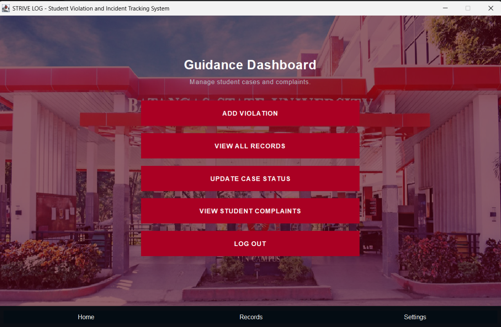

# STRIVE LOG
### Student Tracking and Recording of Incidents Violation Evolution

<p align="center">
  <strong>A Java Swing-Based Student Violation and Incident Tracking System</strong>
</p>

---

## About the Project

**STRIVE LOG** is a Java-based desktop system designed to help schools record, organize, and monitor student violations and complaints. It provides an interface for authorized users to manage incident records, view student violation histories, and monitor case statuses.

The system has four user roles: Students, School Staff, Guidance Counselors, and Instructors. Each role has specific features based on its responsibilities.

## Project Objectives

- Organize student violation records.
- Classify violations into Minor and Major categories.
- Allow authorized users to record and monitor incidents.
- Give students a way to submit complaints.
- Help Guidance Counselors update and monitor case statuses.

## System Features

| Feature | Description |
|---|---|
| User Login | Provides access based on user roles. |
| Add Violation | Records student information and incident details. |
| Violation Classification | Separates Minor and Major violation types. |
| View Records | Displays recorded student violation details. |
| Update Case Status | Allows Guidance Counselors to mark cases as Pending or Resolved. |
| File a Request | Allows students to submit request. |
| Account Settings | Displays account information and provides logout and exit options. |

## User Roles

1. **Student**
   - View personal violation records.
   - Submit complaints.

2. **School Staff**
   - Add student violations.
   - View all violation records.

3. **Guidance Counselor**
   - Add and view violation records.
   - Update case statuses.
   - View student complaints.

4. **Instructor**
   - Add student violations.
   - View all violation records.

## Technologies Used

- **Java** – Main programming language.
- **Java Swing** – Builds the graphical user interface.
- **Java AWT** – Supports interface components and event handling.
- **ArrayList** – Temporarily stores violation records and complaints while the program is running.

## Object-Oriented Programming Concepts

- **Encapsulation** – Uses private fields and public getter methods to protect data.
- **Inheritance** – Allows user subclasses to inherit common properties from the abstract `User` class.
- **Abstraction** – Uses an abstract `User` class to define common user behavior.
- **Polymorphism** – Uses method overriding to define the role of each user type.

## System Screenshots

### Welcome Screen


### User Selection


### Login Screen


### Guidance Counselor Dashboard


### Add Violation Form


## How to Run

**Requirements:**
- Java Development Kit (JDK)
- Java-compatible IDE or terminal

**Steps:**

1. Open the project folder.
2. Make sure `STRIVELOG.java`, `BSU.jpg`, and `strivelogo.png` are in their expected locations.
3. Open a terminal in the project folder.
4. Compile the program:

```bash
javac STRIVELOG.java
```

5. Run the program:

```bash
java STRIVELOG
```

## Sample Login Credentials

| User Role | User ID | Password |
|---|---|---|
| Guidance Counselor | `GC-1001` | `1234` |
| Instructor | `INS-1001` | `1234` |
| School Staff | `SS-1001` | `1234` |
| Student | Any ID starting with `SR-` | Any non-empty password |

## Current Limitations

The system currently uses `ArrayList` to store violation records and complaints. The data is temporary and will be lost when the program closes. Database integration and permanent data storage are not yet implemented.

## Development Team

**Team Name:** Kanin Buseng  
**Team Number:** 7  
**Section:** 2101  
**Course:** OOP 101  
**Academic Year:** 1st Semester, AY 2026–2027

| Member | Role |
|---|---|
| Conceja, Ma. Gay Ann M. | System / Design Lead |
| Pedotera, Jazmine L. | Documentation |
| Villalobos, John Brix P. | Project Leader |

## Repository

[STRIVE LOG – GitHub Repository](https://github.com/jazminepedotera221-create/STRIVE_LOG.git)

---

<p align="center">
  <strong>STRIVE LOG</strong><br>
  <em>Organizing Records, Monitoring Progress, Promoting Accountability.</em>
</p>
