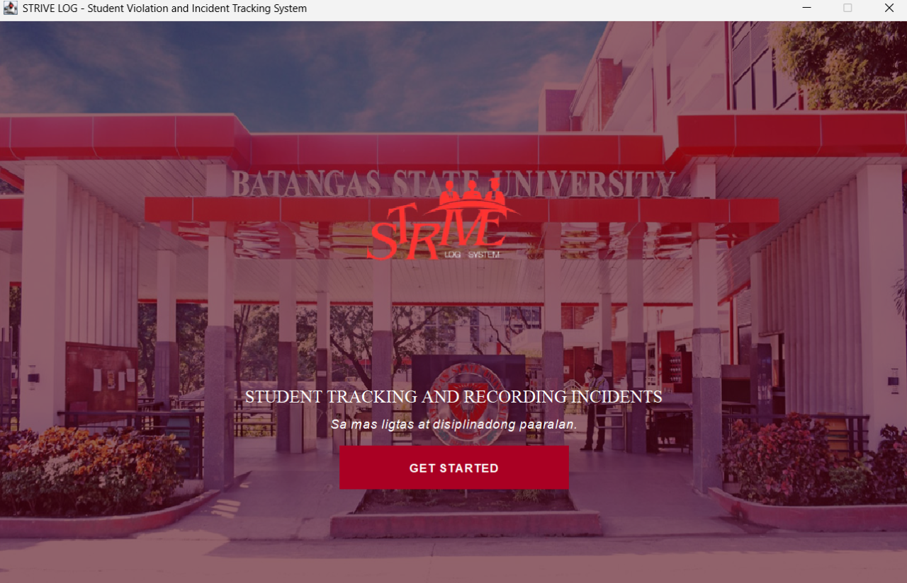
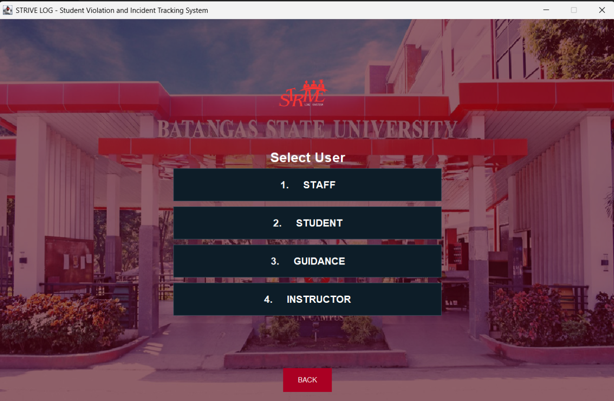
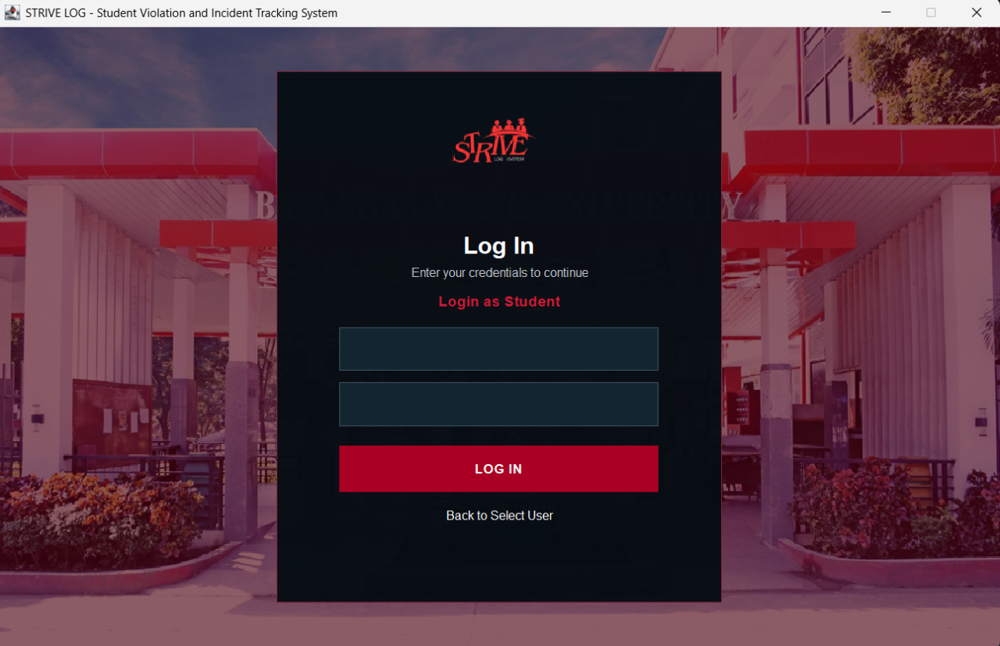
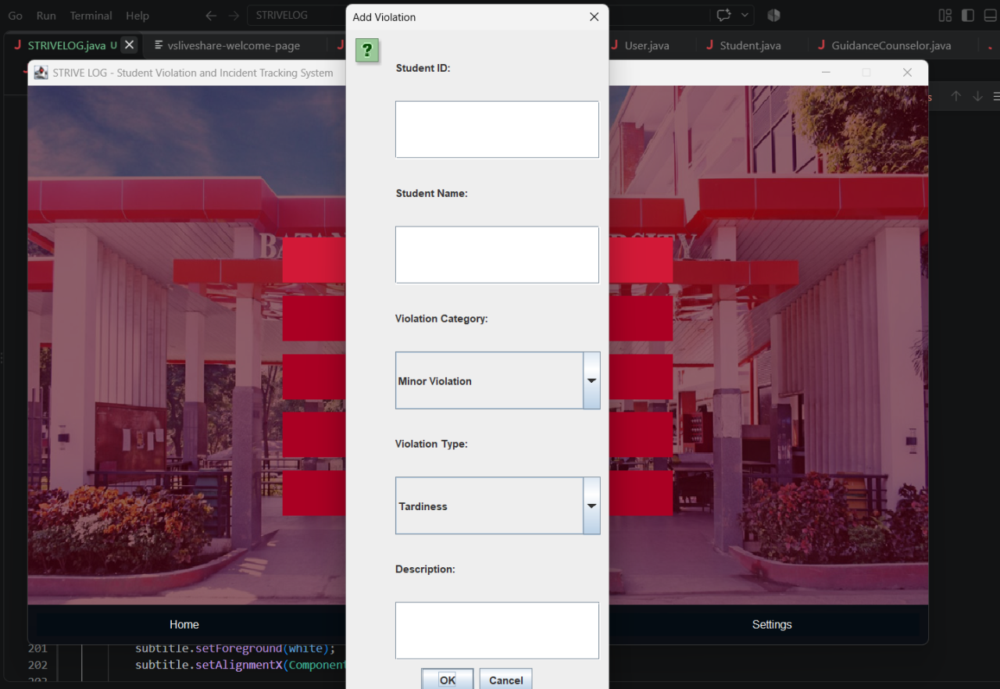

# STRIVE LOG
### Student Tracking and Recording of Incidents Violation Evolution

<p align="center">
  <strong>A Java Swing-Based Student Violation and Incident Tracking System</strong>
</p>

---

## About the Project

**STRIVE LOG** is a Java-based desktop system designed to help schools record, organize, and monitor student violations and complaints. It provides an interface for authorized users to manage incident records, view student violation histories, and monitor case statuses.

The system has four user roles: Students, School Staff, Guidance Counselors, and Instructors. Each role has specific features based on its responsibilities.

## Project Objectives

- Organize student violation records.
- Classify violations into Minor and Major categories.
- Allow authorized users to record and monitor incidents.
- Give students a way to submit complaints.
- Help Guidance Counselors update and monitor case statuses.

## System Features

| Feature | Description |
|---|---|
| Welcome Screen | Displays the system introduction and Get Started button. |
| User Selection | Allows users to select their account role. |
| User Login | Validates user credentials based on the selected role. |
| Add Violation | Records student information and violation details. |
| Violation Classification | Classifies violations into Minor and Major categories. |
| View All Records | Displays all recorded student violations. |
| My Violation Records | Allows students to view their own violation history. |
| Update Case Status | Allows Guidance Counselors to update violation statuses to Pending or Resolved. |
| File a Request | Allows students to submit requests regarding their violations. |
| View Student Requests | Allows Guidance Counselors to review submitted student requests. |
| Account Information | Displays the logged-in user's name, ID, and role. |
| Logout | Returns the user to the welcome screen. |
| Exit Application | Provides an exit confirmation screen followed by a Thank You screen. |

## User Roles

1. **Student**
   - Add student violation records.
   - View personal violation records.
   - Submit requests to the Guidance Counselor.
   - View the status of their recorded violations.

2. **School Staff**
   - Add student violations.
   - View all violation records.

3. **Guidance Counselor**
   - Add and view violation records.
   - View all violation records.
   - Update case statuses.
   - View student request.

4. **Instructor**
   - Add student violations.
   - View all violation records.

## Technologies Used

- **Java** – Main programming language.
- **Java Swing** – Builds the graphical user interface.
- **Java AWT** – Supports interface components and event handling.
- **ArrayList** – Temporarily stores violation records and complaints while the program is running.

## Object-Oriented Programming Concepts

- **Encapsulation** – Uses private fields in the `User` and `Violation` classes and provides public getter methods to access their information. The violation status also has a setter method.
- **Inheritance** – The `Student`, `Guidance Counselor`, `Instructor`, and `SchoolStaff` classes inherit common properties from the abstract `User` class.
- **Abstraction** – Uses an abstract `User` class to define common user behavior.
- **Polymorphism** – Uses method overriding to define the role of each user type.

## System Screenshots

### Welcome Screen


### User Selection


### Login Screen


### Guidance Counselor Dashboard


### Add Violation Form


## How to Run

**Requirements:**
- Java Development Kit (JDK)
- Java-compatible IDE or terminal

**Steps:**

1. Open the project folder.
2. Make sure `STRIVELOG.java`, `BSU.jpg`, and `strivelogo.png` are in their expected locations.
3. Open a terminal in the project folder.
4. Compile the program:

```bash
javac STRIVELOG.java
```

5. Run the program:

```bash
java STRIVELOG
```

## Sample Login Credentials

| User Role | User ID | Password |
|---|---|---|
| Guidance Counselor | `GC-1001` | `1234` |
| Instructor | `INS-1001` | `1234` |
| School Staff | `SS-1001` | `1234` |
| Student | Any ID starting with `SR-` | Any non-empty password |

## Current Limitations

- The system uses `ArrayList` for temporary storage of violation records and student requests.
- All stored records are lost when the application is closed.
- Database integration and permanent data storage have not yet been implemented.
- Student login currently checks the ID format and requires a non-empty password but does not verify actual student account credentials.
- The application uses predefined sample credentials for Guidance Counselors, Instructors, and School Staff.

## Development Team

**Team Name:** Kanin Buseng  
**Team Number:** 7  
**Section:** 2101  
**Course:** OOP 101  
**Academic Year:** 1st Semester, AY 2026–2027

| Member | Role |
|---|---|
| Conceja, Ma. Gay Ann M. | System / Design Lead |
| Pedotera, Jazmine L. | Documentation |
| Villalobos, John Brix P. | Project Leader |

## Repository

[STRIVE LOG – GitHub Repository](https://github.com/jazminepedotera221-create/STRIVE_LOG.git)

---

<p align="center">
  <strong>STRIVE LOG</strong><br>
  <em>Organizing Records, Monitoring Progress, Promoting Accountability.</em>
</p>
